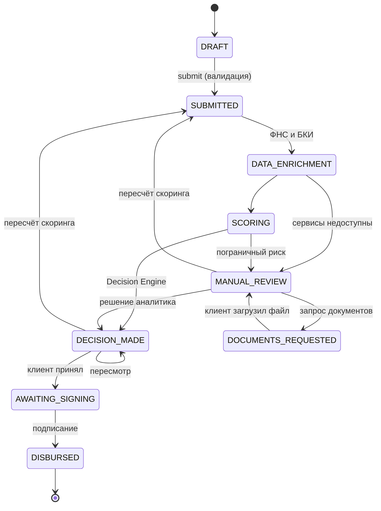

# Архитектура

Система состоит из пяти контейнеров. Отдельных микросервисов для каждой роли нет: клиентский API и кабинет банка живут в одном приложении как независимые модули.

| Контейнер | Роль |
|---|---|
| `core` | Клиентский API, кабинет банка, конечный автомат, скоринг, решение, ИИ-функции, раздача фронта |
| `worker` | Celery-воркер: выполняет кредитный конвейер в фоне |
| `mock` | Эмулятор ФНС и БКИ |
| `db` | PostgreSQL |
| `redis` | Брокер задач Celery |
| `ollama` | Необязательная локальная LLM (профиль `ai`) |

## Кредитный конвейер

1. Клиент отправляет заявку: проверка обязательных полей, переход `DRAFT` → `SUBMITTED`, задача уходит в очередь.
2. Воркер запрашивает данные ФНС и БКИ и сохраняет их в `EnrichmentData`.
3. Скоринг считает балл и список факторов, ИИ формирует резюме.
4. Решение принимается автоматически или заявка передаётся аналитику.
5. Если внешние сервисы недоступны, заявка не теряется, а уходит на ручную проверку.

Обработка идемпотентна: повторный запуск для уже обработанной заявки ничего не делает.

## Статусы заявки

Статусы взяты из ТЗ, добавлен `DOCUMENTS_REQUESTED`: он хранит запрос документов из кабинета банка. Недопустимый переход возвращает ответ 409 с подсказкой, каждый допустимый записывается в `ApplicationStateHistory` (кто, когда, комментарий).

## Модули ядра

| Модуль | Ответственность |
|---|---|
| `statemachine.py` | Таблица переходов, запись аудита |
| `validation.py` | Ошибки и предупреждения мастера, процент заполнения |
| `scoring.py` | Только оценка риска |
| `decision.py` | Только решение по уровню риска и продукту |
| `services.py` | Порядок шагов конвейера |
| `enrichment.py` | Обращение к мок-сервису |
| `ai.py` | Ассистент, разбор отчётности, резюме. Модель и правила взаимозаменяемы |
| `errors.py` | Единый формат ошибок |

Исходники диаграмм в формате Mermaid лежат рядом: `architecture.mmd`, `containers.mmd`, `states.mmd`.
