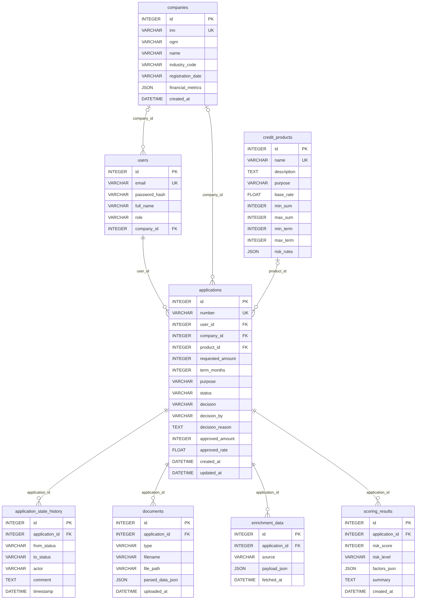

# Модель данных

Схема создаётся миграциями Alembic (`core/migrations`), описание таблиц лежит в [`core/app/models.py`](../core/app/models.py). Диаграмма построена автоматически из этих моделей, исходник в Mermaid: [`data-model.mmd`](data-model.mmd).

## Таблицы

| Таблица | Что хранит |
|---|---|
| `companies` | Компания по ИНН: название, ОГРН, код отрасли, дата регистрации, финансовые показатели из ФНС |
| `users` | Клиенты и аналитики банка: email, хеш пароля, роль (`client`, `analyst`), компания |
| `credit_products` | Каталог продуктов: ставка, пределы суммы и срока, правила риска |
| `applications` | Заявка: сумма, срок, цель, статус конечного автомата, решение, одобренные условия |
| `application_state_history` | Аудит: каждый переход статуса, кто и когда его выполнил, комментарий |
| `documents` | Загруженные файлы и результат разбора отчётности |
| `enrichment_data` | Ответы внешних источников (ФНС, БКИ) по заявке в исходном виде |
| `scoring_results` | Балл, уровень риска, факторы с вкладом каждого и резюме для аналитика |

## Связи

- Компания может иметь несколько пользователей и несколько заявок.
- Пользователь подаёт заявки, заявка всегда привязана к одному пользователю.
- Продукт выбирается в заявке, у заявки без выбранного продукта поле `product_id` пустое.
- Заявка владеет историей переходов, документами, данными внешних источников и результатами скоринга. Скоринг можно пересчитать, поэтому результатов у заявки может быть несколько, актуальный последний.

## Сквозные правила

- Текущий статус заявки хранится в `applications.status`, допустимые переходы описаны в [architecture.md](architecture.md). Прямого изменения статуса в обход конечного автомата нет.
- Каждый успешный переход пишется в `application_state_history`, поэтому хронология заявки восстанавливается полностью.
- Данные внешних источников хранятся как JSON без разбора по колонкам: контракт мока можно менять, не трогая схему.
- Пароли хранятся только в виде хеша (`passlib`, `pbkdf2_sha256`).
